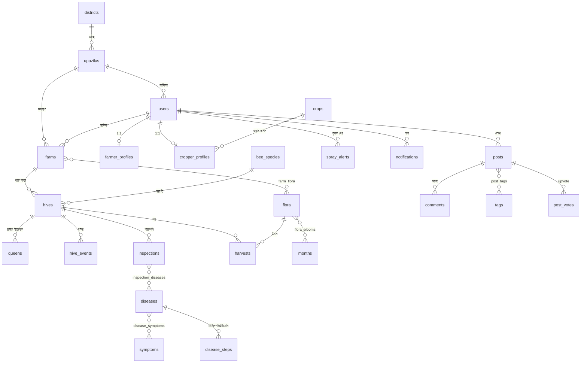

# মৌখামার — ডাটাবেজ ডিজাইন (Normalized)

> frontend-এর ১৬টা page-এর প্রতিটা ফিচার ধরে ধরে বানানো। প্রতিটা টেবিলের পাশে
> লেখা আছে কোন page-এ এটা লাগে।

---

## ১. কেন নতুন করে সাজানো হলো — আগের schema-র সমস্যা

| আগে যা ছিল | কোন নিয়ম ভাঙছিল | এখন যা হলো |
|---|---|---|
| `diseases.signs` / `prevent` / `treat` — একটা TEXT কলামে JSON string | **1NF** (একটা ঘরে একাধিক মান) | `symptoms`, `disease_symptoms` (M:N), `disease_steps` টেবিল |
| `flora.months` — `"[11,12,1]"` string | **1NF** | `flora_blooms` (flora_id, month_no) |
| `community_posts.tags` — কমা দিয়ে লেখা | **1NF** | `tags` + `post_tags` (M:N) |
| `farms.flora` — একটাই ফুলের নাম, অথচ API-তে hardcoded list পাঠানো হচ্ছিল | **1NF** | `farm_flora` (M:N) |
| `inspections.disease_signs` — TEXT | **1NF** | `inspection_diseases` (M:N, severity সহ) |
| `users.district` + `upazila` — দুটোই string, প্রতি সারিতে বারবার; জেলার coordinate কোথাও নেই (এজন্যই `DISTRICT_COORDS` bug) | **3NF** (transitive dependency: জেলার তথ্য ব্যবহারকারীর উপর নির্ভর করে না) | `districts` (lat/lng সহ) → `upazilas` → সবাই শুধু `upazila_id` রাখে |
| `users`-এ খামারি ও কৃষকের কলাম একসাথে (খামারির `main_crop` খালি, কৃষকের `farm_name` খালি) | **3NF/BCNF** চেতনা | `farmer_profiles`, `cropper_profiles` (1:1) |
| `hives.queen`, `queen_age`, `queen_source`, `queen_color` | রানী বদলের **ইতিহাস** হারিয়ে যায় (অথচ `hive.html`-এ "রানী বদল" আছে) | `queens` টেবিল (1:M), চলতি রানী = `removed_on IS NULL` |
| `hives.last_inspection_days` — সংখ্যা হিসেব করে রাখা | **derived data**, একদিন পরেই ভুল | `v_hive_status` ভিউ, `DATEDIFF` দিয়ে সবসময় তাজা |
| `outbreaks` — `disease_name`, `where`, `farms_affected` হাতে লেখা | derived + 2NF | `v_area_outbreaks` ভিউ, `inspection_diseases` থেকে গোনা |
| `users.main_crop` — string | 3NF | `crops` lookup টেবিল |
| কোনো পরিবর্তনের হিসাব রাখা হচ্ছিল না | — | `audit_log` (trigger দিয়ে ভরে) |

---

## ২. টেবিলের তালিকা (৩০টা)

### ক. এলাকা (lookup, 1:M শিকল)
| টেবিল | কলাম | কোথায় লাগে |
|---|---|---|
| `districts` | id, name(UQ), lat, lng | register, map, directory |
| `upazilas` | id, district_id→, name, UQ(district_id,name) | cascading dropdown |

### খ. মানুষ
| টেবিল | কলাম | কোথায় লাগে |
|---|---|---|
| `users` | id, phone(UQ), email(UQ), name, password, role, upazila_id→, is_active, is_staff, created_at | login, register, admin |
| `farmer_profiles` | user_id(PK,1:1)→, farm_name, farm_type, experience_years | profile, directory |
| `cropper_profiles` | user_id(PK,1:1)→, main_crop_id→ | alerts |
| `crops` | id, name(UQ) | স্প্রে নোটিশের ফসল |

### গ. খামার ও বাক্স
| টেবিল | কলাম | কোথায় লাগে |
|---|---|---|
| `farms` | id, owner_id→, name, upazila_id→, farm_type, status, lat, lng, created_at | hives, map, dashboard |
| `farm_flora` | farm_id→, flora_id→ (M:N) | directory-র ফুল filter |
| `bee_species` | id, name(UQ), sci_name, note | bees, hive |
| `hives` | id, code(UQ), farm_id→, species_id→, frames, filled, state, installed_on | hives, hive |
| `queens` | id, hive_id→, source, color_mark, installed_on, removed_on, note | hive — রানী বসানো/বদল |
| `hive_events` | id, hive_id→, event_date, kind, note, actor_id→ | hive — ইতিহাস |

### ঘ. পরিদর্শন ও রোগ
| টেবিল | কলাম | কোথায় লাগে |
|---|---|---|
| `inspections` | id, hive_id→, inspector_id→, inspect_date, frames_filled, state, queen_seen, eggs_seen, notes, UQ(hive_id,inspect_date) | inspections |
| `symptoms` | id, code(UQ), name | diseases — লক্ষণ বাছাই |
| `diseases` | id, code(UQ), name, kind, risk, cause, spread | diseases |
| `disease_symptoms` | disease_id→, symptom_id→ (M:N) | **লক্ষণ দিয়ে রোগ খোঁজা** |
| `disease_steps` | id, disease_id→, kind('treat'/'prevent'), step_no, text | ধাপে ধাপে চিকিৎসা |
| `inspection_diseases` | inspection_id→, disease_id→, severity (M:N) | পাওয়া রোগ, outbreak |

### ঙ. মধু ও ফুল
| টেবিল | কলাম | কোথায় লাগে |
|---|---|---|
| `harvests` | id, hive_id→, harvester_id→, harvest_date, kg, moisture, flora_id→, notes | harvests |
| `flora` | id, name(UQ), where_found, is_dearth | calendar |
| `flora_blooms` | flora_id→, month_no 1–12 (M:N) | ফুলের ক্যালেন্ডার |
| `months` | month_no(PK) ১–১২, name_bn | ক্যালেন্ডারে বাংলা মাসের নাম |

### চ. সতর্কতা
| টেবিল | কলাম | কোথায় লাগে |
|---|---|---|
| `spray_alerts` | id, cropper_id→, upazila_id→, spray_date, spray_time, crop_id→, chemical, notes | alerts — কৃষকের form |
| `notifications` | id, recipient_id→, kind, title, body, ref_table, ref_id, unread, created_at | alerts, dashboard |

### ছ. কমিউনিটি
| টেবিল | কলাম | কোথায় লাগে |
|---|---|---|
| `posts` | id, author_id→, category, title, body, resource_type, price, upvote_count | community |
| `tags` | id, name(UQ) | community filter |
| `post_tags` | post_id→, tag_id→ (M:N) | community |
| `comments` | id, post_id→, author_id→, text, created_at | community |
| `post_votes` | post_id→, user_id→, UQ(post_id,user_id) | একজন একবারই upvote |

### জ. নিরীক্ষা
| টেবিল | কলাম | কোথায় লাগে |
|---|---|---|
| `audit_log` | id, table_name, row_pk, action, actor_id, old_data JSON, new_data JSON, changed_at | admin |

---

## ৩. ER ডায়াগ্রাম (মূল অংশ)

---

## ৪. কোন MySQL topic কোন ফাইলে থাকবে

| ফাইল | কী থাকে | অবস্থা |
|---|---|---|
| `sql/01_create_database.sql` | CREATE DATABASE, utf8mb4, event scheduler চালু | ✅ |
| *Django migration* | ৩০টা টেবিল, PK, FK, UNIQUE, DEFAULT, ৬১টা index | ✅ |
| `sql/02_constraints.sql` | ২৮টা CHECK constraint (আর্দ্রতা ≤ ৩০%, ফ্রেম, কেজি, ফোনের format, ভূমিকা, অবস্থা, অবস্থান) | ✅ |
| `sql/03_indexes.sql` | ৩টা FULLTEXT, covering ও composite index | ✅ |
| `sql/04_fk_actions.sql` | প্রতিটা FK-র ON DELETE নিয়ম (২৭ CASCADE, ৭ SET NULL, ৪ RESTRICT) — dynamic SQL দিয়ে | ✅ |
| `sql/05_views.sql` | ৮টা ভিউ (hive status, overdue, farm summary, farmer directory, monthly honey, outbreak, disease-symptom, dashboard) | ✅ |
| `sql/06_functions.sql` | ৮টা FUNCTION (বাংলা অঙ্ক, মধুর যোগফল, রানীর বয়স, স্বাস্থ্যের নম্বর) | ✅ |
| `sql/07_procedures.sql` | ৬টা PROCEDURE — transaction, SIGNAL, EXIT HANDLER, CURSOR, SAVEPOINT, OUT প্যারামিটার | ✅ |
| `sql/08_triggers.sql` | ১২টা TRIGGER — স্প্রে fan-out, upvote গণনা, রোগের সতর্কতা, যে যাচাই CHECK পারে না, audit log | ✅ |
| `sql/09_events.sql` | ৩টা EVENT — রাতের সতর্কতা, পুরনো notification মোছা, ফুল কম মৌসুমের খবর | ✅ |
| `sql/10_seed.sql` | ৬৪ জেলা, ৫০১ উপজেলা, ৮টা রোগ, ৪৮টা ধাপ, ফুল, প্রজাতি — `data.js` থেকে তৈরি | ✅ |
| `sql/11_users_grants.sql` | ৩টা ROLE, ৩টা ব্যবহারকারী, GRANT/REVOKE, dynamic SQL দিয়ে টেবিল-ভিত্তিক অনুমতি | ✅ |
| `queries/*.sql` | ৬টা ফাইল — topic অনুযায়ী viva-র জন্য তৈরি query ও demo | ✅ |

**বের করে রাখা ফাইল** (হাতে লেখা নয়, script-এ তৈরি):

| ফাইল | কী | কীভাবে আবার বানাবেন |
|---|---|---|
| `sql/schema_dump.sql` | পুরো schema এক ফাইলে — টেবিল, ভিউ, routine, trigger, event (সারি ছাড়া) | `.\db.ps1 -Dump` |
| `sql/ERD.md` | ER ডায়াগ্রাম (mermaid), ON DELETE তালিকা, প্রতিটা টেবিলের কলাম | `python sql\gen_erd.py` |
| `sql/10_seed.sql` | reference ডাটার INSERT | `node sql\gen_seed.js ..\moukamar_frontend\js sql\10_seed.sql` |

প্রতিটা `sql/NN_*.sql`-এর সাথে একটা `NN_*_down.sql` আছে — migration পেছনে
নিলে ওটা চলে।

**টেবিল কে বানায়:** Django migration (`python manage.py migrate`), যাতে ORM আর API ঠিকমতো চলে।
**বাকি সব** (CHECK, index, FK নিয়ম, view, procedure, function, trigger, event, grant) হাতে লেখা `sql/` ফাইলে — আর সেগুলোও `apps/dbschema`-র migration থেকে চলে। তাই `migrate` একটা কমান্ডেই পুরো ডাটাবেজ দাঁড়িয়ে যায়।
শেষে জমা দেওয়ার জন্য `mysqldump` দিয়ে পুরো `schema.sql` বের করে দেব।

### একটা জরুরি কথা — Django-র `on_delete` ডাটাবেজে বসে না

Model-এ `on_delete=models.CASCADE` লেখা থাকলেও Django সেটা **Python-এ**
করে: আগে সন্তান সারিগুলো মুছে, তারপর মা-সারি। ডাটাবেজে প্রতিটা
FOREIGN KEY আসলে ডিফল্ট RESTRICT হয়ে বসে থাকে।

ফল: অ্যাপের ভেতর দিয়ে গেলে ঠিকই চলে, কিন্তু কেউ সরাসরি SQL দিয়ে
খামার মুছতে গেলে আটকে যায় — আর schema-তে `ON DELETE CASCADE` কোথাও
দেখা যায় না। `sql/04_fk_actions.sql` এই ফাঁকটা পূরণ করে।

Django-র তৈরি FK-র নামে hash থাকে (`hives_farm_id_b91a1af7_fk_farms_id`),
যা মেশিনে মেশিনে আলাদা — তাই নাম হাতে লেখা যায় না। `sp_set_fk_action`
procedure `information_schema` থেকে নাম খুঁজে, dynamic SQL (`PREPARE` /
`EXECUTE`) দিয়ে FK টা সরিয়ে নতুন নিয়মে বসায়।

---

## ৫. কোন MySQL topic কোথায় আছে

> presentation বা viva-তে স্যার কোনো topic দেখতে চাইলে এই তালিকা থেকে
> সোজা ফাইল আর demo বের করা যাবে।

| topic | কোথায় বানানো | কোথায় দেখাবেন |
|---|---|---|
| ER ডায়াগ্রাম, normalization (1NF→3NF) | `00_DESIGN.md`, `ERD.md` | দুটো ফাইলই |
| CREATE DATABASE, utf8mb4, collation | `01_create_database.sql` | `queries/00_inspect.sql` |
| Data type, DECIMAL, DATE, JSON | সব টেবিল | `ERD.md`-এর কলামের তালিকা |
| PRIMARY KEY, AUTO_INCREMENT | সব টেবিল | `queries/00_inspect.sql` |
| FOREIGN KEY, ON DELETE CASCADE/SET NULL/RESTRICT | `04_fk_actions.sql` | `queries/01_constraints.sql` (১৪–১৫) |
| UNIQUE constraint | model + `02_constraints.sql` | `queries/01_constraints.sql` (১১–১৩) |
| CHECK constraint (২৮টা) | `02_constraints.sql` | `queries/01_constraints.sql` (১–৯) |
| NOT NULL, DEFAULT | সব টেবিল | `ERD.md` |
| M:N junction টেবিল (৬টা) | model + `10_seed.sql` | `queries/03_views.sql` (৯) |
| 1:1 সম্পর্ক | `farmer_profiles`, `cropper_profiles` | `ERD.md` |
| INSERT / UPDATE / DELETE | `10_seed.sql`, সব procedure | `queries/01`, `04` |
| JOIN — INNER, LEFT | `05_views.sql` | `queries/03_views.sql` (৫) |
| Aggregate — COUNT, SUM, AVG, MIN, MAX | `05_views.sql` | `queries/03_views.sql` (৪) |
| GROUP BY, HAVING | `05_views.sql` | `queries/03_views.sql` (৪) |
| GROUP_CONCAT | `v_farm_summary`, `v_disease_symptoms` | `queries/03_views.sql` (৬, ৯) |
| Subquery — scalar, correlated | `v_farm_summary`, `v_farmer_directory` | `queries/03_views.sql` (৭) |
| EXISTS / NOT EXISTS | `09_events.sql`, `FarmerList` | `queries/06_events_users.sql` (৩) |
| UNION / UNION ALL | `queries/00_inspect.sql` | ওই ফাইল |
| derived table (FROM-এর ভেতরে SELECT) | `v_hive_status` | `queries/01_constraints.sql` (৯) |
| CASE, IF, IFNULL, COALESCE, GREATEST | `05_views.sql`, `06_functions.sql` | `queries/03`, `04` |
| তারিখের function — DATEDIFF, TIMESTAMPDIFF, DATE_SUB | `05_views.sql` | `queries/03_views.sql` (২) |
| string function — CONCAT, REPLACE, SUBSTRING, FORMAT | `06_functions.sql` | `queries/04_routines.sql` (৩) |
| VIEW (৮টা) | `05_views.sql` | `queries/03_views.sql` |
| ভিউয়ের উপর ভিউ | `v_overdue_hives`, `v_farmer_dashboard` | `queries/03_views.sql` (৩) |
| stored FUNCTION (৮টা) | `06_functions.sql` | `queries/04_routines.sql` (২–৩) |
| stored PROCEDURE (৬টা) | `07_procedures.sql` | `queries/04_routines.sql` |
| IN / OUT প্যারামিটার | `sp_season_report` | `queries/04_routines.sql` (৪) |
| TRANSACTION — COMMIT, ROLLBACK | `sp_move_hive`, `sp_add_harvest` | `queries/01`, `03`, `05` |
| SAVEPOINT, আংশিক ROLLBACK | `sp_record_inspection` | `queries/04_routines.sql` (৮) |
| SIGNAL SQLSTATE (নিজের ভুলের বার্তা) | সব procedure, ৩টা trigger | `queries/04`, `05` |
| DECLARE HANDLER (EXIT, CONTINUE) | `07_procedures.sql` | `queries/04_routines.sql` |
| CURSOR + LOOP | `sp_notify_overdue_inspections` | `queries/04_routines.sql` (৭) |
| WHILE লুপ | `fn_bn_digits`, `sp_record_inspection` | `queries/04_routines.sql` (৩, ৮) |
| dynamic SQL — PREPARE / EXECUTE | `04_fk_actions.sql`, `11_users_grants.sql` | ওই দুই ফাইল |
| TRIGGER (১২টা) — BEFORE/AFTER, INSERT/UPDATE/DELETE | `08_triggers.sql` | `queries/05_triggers.sql` |
| OLD / NEW, `<=>` (NULL-safe তুলনা) | `08_triggers.sql` | `queries/05_triggers.sql` (৭) |
| audit / নিরীক্ষার হিসাব | `08_triggers.sql` + `audit_log` | `queries/05_triggers.sql` (৭–৮) |
| JSON — JSON_OBJECT, `->>` | audit trigger গুলো | `queries/05_triggers.sql` (৭) |
| EVENT (scheduled job, ৩টা) | `09_events.sql` | `queries/06_events_users.sql` (১–৪) |
| INDEX — single, composite, covering | `03_indexes.sql` | `queries/02_indexes.sql` |
| FULLTEXT index ও MATCH ... AGAINST | `03_indexes.sql` | `queries/02_indexes.sql` (২) |
| EXPLAIN, EXPLAIN ANALYZE | — | `queries/02_indexes.sql` (৬) |
| recursive CTE (WITH RECURSIVE) | — | `queries/02_indexes.sql` (৬) |
| information_schema | সব `*_down.sql`, `gen_erd.py` | `queries/00_inspect.sql` |
| USER, ROLE, GRANT, REVOKE | `11_users_grants.sql` | `queries/06_events_users.sql` (৫–৭) |
| mysqldump দিয়ে ব্যাকআপ | `db.ps1 -Dump` | `schema_dump.sql` |

### যে দুটো জিনিস ইচ্ছে করে দেখানো হয়েছে

**১. CHECK constraint-এর সীমা।** CHECK-এ `CURDATE()` চলে না আর অন্য
টেবিল দেখা যায় না। তাই "ভবিষ্যতের তারিখে মধু নয়", "ভরা ফ্রেম মোট
ফ্রেমের বেশি নয়" আর "এক বাক্সে দুজন চলতি রানী নয়" — এই তিনটে নিয়ম
trigger দিয়ে করতে হয়েছে। `02_constraints.sql`-এর শেষে কারণ লেখা আছে।

**২. Django-র `on_delete` ডাটাবেজে বসে না।** ORM Python-এ cascade করে,
ডাটাবেজে প্রতিটা FK RESTRICT হয়ে থাকে। `04_fk_actions.sql` সেটা ঠিক
করে — আর Django-র FK-র নামে hash থাকে বলে নামটা `information_schema`
থেকে খুঁজে dynamic SQL দিয়ে বদলাতে হয়েছে।
