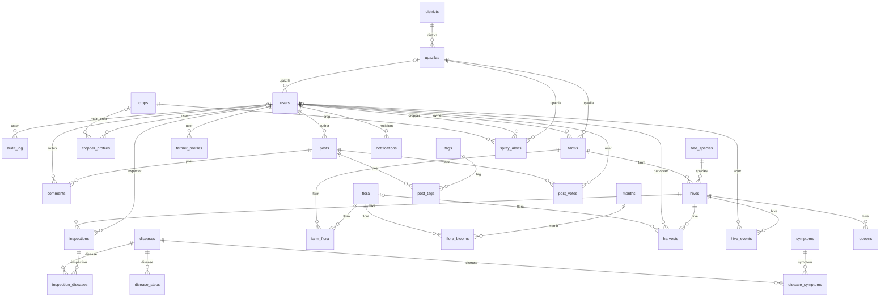

# মৌখামার — ER ডায়াগ্রাম ও টেবিলের তালিকা

> এই ফাইলটা হাতে লেখা নয় — `sql/gen_erd.py` চলতি ডাটাবেজের
> `information_schema` থেকে পড়ে বানায়। schema বদলালে আবার
> চালালেই হালনাগাদ হয়ে যায়।

**টেবিল:** 30টি · **সম্পর্ক (FOREIGN KEY):** 38টি

ছাপানোর জন্য ছবি দরকার হলে MySQL Workbench-এ
*Database → Reverse Engineer* দিলে নিজে এঁকে দেয়।

## ER ডায়াগ্রাম

`||--o{` মানে মা-সারি থাকতেই হবে, `|o--o{` মানে ঐচ্ছিক (NULL চলে)।

## FOREIGN KEY-র ON DELETE নিয়ম

| সন্তান | কলাম | মা-টেবিল | মা-সারি মুছলে |
|---|---|---|---|
| `comments` | `author_id` | `users` | CASCADE — সন্তানও মুছবে |
| `comments` | `post_id` | `posts` | CASCADE — সন্তানও মুছবে |
| `cropper_profiles` | `user_id` | `users` | CASCADE — সন্তানও মুছবে |
| `disease_steps` | `disease_id` | `diseases` | CASCADE — সন্তানও মুছবে |
| `disease_symptoms` | `disease_id` | `diseases` | CASCADE — সন্তানও মুছবে |
| `disease_symptoms` | `symptom_id` | `symptoms` | CASCADE — সন্তানও মুছবে |
| `farm_flora` | `farm_id` | `farms` | CASCADE — সন্তানও মুছবে |
| `farm_flora` | `flora_id` | `flora` | CASCADE — সন্তানও মুছবে |
| `farmer_profiles` | `user_id` | `users` | CASCADE — সন্তানও মুছবে |
| `farms` | `owner_id` | `users` | CASCADE — সন্তানও মুছবে |
| `flora_blooms` | `flora_id` | `flora` | CASCADE — সন্তানও মুছবে |
| `flora_blooms` | `month_id` | `months` | CASCADE — সন্তানও মুছবে |
| `harvests` | `hive_id` | `hives` | CASCADE — সন্তানও মুছবে |
| `hive_events` | `hive_id` | `hives` | CASCADE — সন্তানও মুছবে |
| `hives` | `farm_id` | `farms` | CASCADE — সন্তানও মুছবে |
| `inspection_diseases` | `disease_id` | `diseases` | CASCADE — সন্তানও মুছবে |
| `inspection_diseases` | `inspection_id` | `inspections` | CASCADE — সন্তানও মুছবে |
| `inspections` | `hive_id` | `hives` | CASCADE — সন্তানও মুছবে |
| `notifications` | `recipient_id` | `users` | CASCADE — সন্তানও মুছবে |
| `post_tags` | `post_id` | `posts` | CASCADE — সন্তানও মুছবে |
| `post_tags` | `tag_id` | `tags` | CASCADE — সন্তানও মুছবে |
| `post_votes` | `post_id` | `posts` | CASCADE — সন্তানও মুছবে |
| `post_votes` | `user_id` | `users` | CASCADE — সন্তানও মুছবে |
| `posts` | `author_id` | `users` | CASCADE — সন্তানও মুছবে |
| `queens` | `hive_id` | `hives` | CASCADE — সন্তানও মুছবে |
| `spray_alerts` | `cropper_id` | `users` | CASCADE — সন্তানও মুছবে |
| `upazilas` | `district_id` | `districts` | CASCADE — সন্তানও মুছবে |
| `farms` | `upazila_id` | `upazilas` | RESTRICT — মোছাই যাবে না |
| `hives` | `species_id` | `bee_species` | RESTRICT — মোছাই যাবে না |
| `spray_alerts` | `crop_id` | `crops` | RESTRICT — মোছাই যাবে না |
| `spray_alerts` | `upazila_id` | `upazilas` | RESTRICT — মোছাই যাবে না |
| `audit_log` | `actor_id` | `users` | SET NULL — ফাঁকা হবে |
| `cropper_profiles` | `main_crop_id` | `crops` | SET NULL — ফাঁকা হবে |
| `harvests` | `flora_id` | `flora` | SET NULL — ফাঁকা হবে |
| `harvests` | `harvester_id` | `users` | SET NULL — ফাঁকা হবে |
| `hive_events` | `actor_id` | `users` | SET NULL — ফাঁকা হবে |
| `inspections` | `inspector_id` | `users` | SET NULL — ফাঁকা হবে |
| `users` | `upazila_id` | `upazilas` | SET NULL — ফাঁকা হবে |

## টেবিলের কলাম

### এলাকা

**`districts`**

| কলাম | ধরন | NULL | key |
|---|---|---|---|
| `id` | bigint | — | PK |
| `name` | varchar(60) | — | UNIQUE |
| `lat` | decimal(10,7) | হ্যাঁ |  |
| `lng` | decimal(10,7) | হ্যাঁ |  |

**`upazilas`**

| কলাম | ধরন | NULL | key |
|---|---|---|---|
| `id` | bigint | — | PK |
| `name` | varchar(60) | — | index |
| `district_id` | bigint | — | index |

### মানুষ

**`users`**

| কলাম | ধরন | NULL | key |
|---|---|---|---|
| `id` | bigint | — | PK |
| `password` | varchar(128) | — |  |
| `last_login` | datetime(6) | হ্যাঁ |  |
| `is_superuser` | tinyint(1) | — |  |
| `phone` | varchar(15) | হ্যাঁ | UNIQUE |
| `email` | varchar(255) | হ্যাঁ | UNIQUE |
| `name` | varchar(100) | — |  |
| `role` | varchar(10) | — | index |
| `is_active` | tinyint(1) | — |  |
| `is_staff` | tinyint(1) | — |  |
| `created_at` | datetime(6) | — |  |
| `upazila_id` | bigint | হ্যাঁ | index |

**`farmer_profiles`**

| কলাম | ধরন | NULL | key |
|---|---|---|---|
| `user_id` | bigint | — | PK |
| `farm_name` | varchar(120) | — |  |
| `farm_type` | varchar(15) | — |  |
| `experience_years` | smallint unsigned | — |  |
| `rating` | decimal(2,1) | — |  |

**`cropper_profiles`**

| কলাম | ধরন | NULL | key |
|---|---|---|---|
| `user_id` | bigint | — | PK |
| `main_crop_id` | bigint | হ্যাঁ | index |

### খামার ও বাক্স

**`farms`**

| কলাম | ধরন | NULL | key |
|---|---|---|---|
| `id` | bigint | — | PK |
| `name` | varchar(120) | — |  |
| `farm_type` | varchar(15) | — |  |
| `status` | varchar(15) | — |  |
| `established_on` | date | হ্যাঁ |  |
| `lat` | decimal(10,7) | হ্যাঁ |  |
| `lng` | decimal(10,7) | হ্যাঁ |  |
| `created_at` | datetime(6) | — |  |
| `owner_id` | bigint | — | index |
| `upazila_id` | bigint | — | index |

**`farm_flora`**

| কলাম | ধরন | NULL | key |
|---|---|---|---|
| `id` | bigint | — | PK |
| `farm_id` | bigint | — | index |
| `flora_id` | bigint | — | index |

**`hives`**

| কলাম | ধরন | NULL | key |
|---|---|---|---|
| `id` | bigint | — | PK |
| `code` | varchar(20) | — | UNIQUE |
| `frames` | smallint unsigned | — |  |
| `filled` | smallint unsigned | — |  |
| `state` | varchar(15) | — |  |
| `installed_on` | date | হ্যাঁ |  |
| `created_at` | datetime(6) | — |  |
| `farm_id` | bigint | — | index |
| `species_id` | bigint | — | index |

**`queens`**

| কলাম | ধরন | NULL | key |
|---|---|---|---|
| `id` | bigint | — | PK |
| `source` | varchar(80) | — |  |
| `color_mark` | varchar(20) | — |  |
| `installed_on` | date | — |  |
| `removed_on` | date | হ্যাঁ |  |
| `note` | varchar(200) | — |  |
| `hive_id` | bigint | — | index |

**`hive_events`**

| কলাম | ধরন | NULL | key |
|---|---|---|---|
| `id` | bigint | — | PK |
| `event_date` | date | — |  |
| `kind` | varchar(10) | — |  |
| `note` | varchar(300) | — |  |
| `created_at` | datetime(6) | — |  |
| `actor_id` | bigint | হ্যাঁ | index |
| `hive_id` | bigint | — | index |

### পরিদর্শন ও রোগ

**`inspections`**

| কলাম | ধরন | NULL | key |
|---|---|---|---|
| `id` | bigint | — | PK |
| `inspect_date` | date | — | index |
| `frames_filled` | smallint unsigned | — |  |
| `state` | varchar(15) | — |  |
| `queen_seen` | tinyint(1) | — |  |
| `eggs_seen` | tinyint(1) | — |  |
| `notes` | longtext | — |  |
| `created_at` | datetime(6) | — |  |
| `hive_id` | bigint | — | index |
| `inspector_id` | bigint | হ্যাঁ | index |

**`inspection_diseases`**

| কলাম | ধরন | NULL | key |
|---|---|---|---|
| `id` | bigint | — | PK |
| `severity` | varchar(5) | — |  |
| `disease_id` | bigint | — | index |
| `inspection_id` | bigint | — | index |

**`diseases`**

| কলাম | ধরন | NULL | key |
|---|---|---|---|
| `id` | bigint | — | PK |
| `code` | varchar(20) | — | UNIQUE |
| `name` | varchar(100) | — | index |
| `kind` | varchar(50) | — |  |
| `risk` | varchar(5) | — | index |
| `cause` | longtext | — |  |
| `spread` | longtext | — |  |

**`disease_symptoms`**

| কলাম | ধরন | NULL | key |
|---|---|---|---|
| `id` | bigint | — | PK |
| `disease_id` | bigint | — | index |
| `symptom_id` | bigint | — | index |

**`disease_steps`**

| কলাম | ধরন | NULL | key |
|---|---|---|---|
| `id` | bigint | — | PK |
| `kind` | varchar(10) | — |  |
| `step_no` | smallint unsigned | — |  |
| `text` | varchar(300) | — | index |
| `disease_id` | bigint | — | index |

**`symptoms`**

| কলাম | ধরন | NULL | key |
|---|---|---|---|
| `id` | bigint | — | PK |
| `code` | varchar(10) | — | UNIQUE |
| `name` | varchar(120) | — | index |

### মধু ও ফুল

**`harvests`**

| কলাম | ধরন | NULL | key |
|---|---|---|---|
| `id` | bigint | — | PK |
| `harvest_date` | date | — | index |
| `kg` | decimal(7,2) | — |  |
| `moisture` | decimal(5,1) | হ্যাঁ |  |
| `notes` | longtext | — |  |
| `created_at` | datetime(6) | — |  |
| `flora_id` | bigint | হ্যাঁ | index |
| `harvester_id` | bigint | হ্যাঁ | index |
| `hive_id` | bigint | — | index |

**`flora`**

| কলাম | ধরন | NULL | key |
|---|---|---|---|
| `id` | bigint | — | PK |
| `name` | varchar(80) | — | UNIQUE |
| `where_found` | varchar(200) | — |  |
| `is_dearth` | tinyint(1) | — |  |

**`flora_blooms`**

| কলাম | ধরন | NULL | key |
|---|---|---|---|
| `id` | bigint | — | PK |
| `flora_id` | bigint | — | index |
| `month_id` | smallint unsigned | — | index |

**`months`**

| কলাম | ধরন | NULL | key |
|---|---|---|---|
| `month_no` | smallint unsigned | — | PK |
| `name_bn` | varchar(20) | — |  |

### সতর্কতা

**`spray_alerts`**

| কলাম | ধরন | NULL | key |
|---|---|---|---|
| `id` | bigint | — | PK |
| `spray_date` | date | — |  |
| `spray_time` | varchar(50) | — |  |
| `chemical` | varchar(100) | — |  |
| `notes` | longtext | — |  |
| `created_at` | datetime(6) | — |  |
| `crop_id` | bigint | — | index |
| `cropper_id` | bigint | — | index |
| `upazila_id` | bigint | — | index |

**`notifications`**

| কলাম | ধরন | NULL | key |
|---|---|---|---|
| `id` | bigint | — | PK |
| `kind` | varchar(15) | — |  |
| `title` | varchar(200) | — |  |
| `body` | longtext | — |  |
| `ref_table` | varchar(64) | — |  |
| `ref_id` | bigint | হ্যাঁ |  |
| `unread` | tinyint(1) | — |  |
| `created_at` | datetime(6) | — |  |
| `recipient_id` | bigint | — | index |

**`crops`**

| কলাম | ধরন | NULL | key |
|---|---|---|---|
| `id` | bigint | — | PK |
| `name` | varchar(50) | — | UNIQUE |

### কমিউনিটি

**`posts`**

| কলাম | ধরন | NULL | key |
|---|---|---|---|
| `id` | bigint | — | PK |
| `category` | varchar(15) | — | index |
| `title` | varchar(200) | — |  |
| `body` | longtext | — |  |
| `resource_type` | varchar(50) | — |  |
| `price` | varchar(80) | — |  |
| `upvote_count` | int unsigned | — |  |
| `created_at` | datetime(6) | — |  |
| `author_id` | bigint | — | index |

**`tags`**

| কলাম | ধরন | NULL | key |
|---|---|---|---|
| `id` | bigint | — | PK |
| `name` | varchar(50) | — | UNIQUE |

**`post_tags`**

| কলাম | ধরন | NULL | key |
|---|---|---|---|
| `id` | bigint | — | PK |
| `post_id` | bigint | — | index |
| `tag_id` | bigint | — | index |

**`post_votes`**

| কলাম | ধরন | NULL | key |
|---|---|---|---|
| `id` | bigint | — | PK |
| `created_at` | datetime(6) | — |  |
| `post_id` | bigint | — | index |
| `user_id` | bigint | — | index |

**`comments`**

| কলাম | ধরন | NULL | key |
|---|---|---|---|
| `id` | bigint | — | PK |
| `text` | longtext | — |  |
| `created_at` | datetime(6) | — |  |
| `author_id` | bigint | — | index |
| `post_id` | bigint | — | index |

### তথ্যভাণ্ডার

**`bee_species`**

| কলাম | ধরন | NULL | key |
|---|---|---|---|
| `id` | bigint | — | PK |
| `name` | varchar(60) | — | UNIQUE |
| `sci_name` | varchar(80) | — |  |
| `note` | longtext | — |  |

### নিরীক্ষা

**`audit_log`**

| কলাম | ধরন | NULL | key |
|---|---|---|---|
| `id` | bigint | — | PK |
| `table_name` | varchar(64) | — | index |
| `row_pk` | bigint | — |  |
| `action` | varchar(6) | — |  |
| `old_data` | json | হ্যাঁ |  |
| `new_data` | json | হ্যাঁ |  |
| `changed_at` | datetime(6) | — | index |
| `actor_id` | bigint | হ্যাঁ | index |

